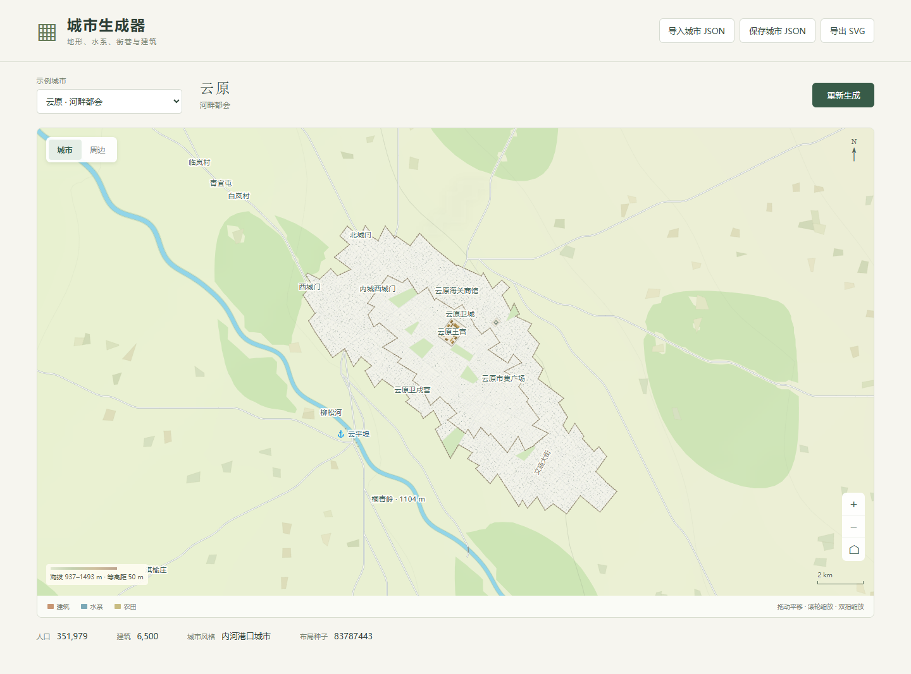

# 城市生成器 · City Generator

从 World Atlas Engine 中独立拆出的城市地图生成器。浏览器按城市配方和局部地理数据生成地形、水系、街巷、建筑、城防、农田与港口，并绘制可缩放的 SVG 地图。

内置 6 个示例：河畔都会、沿海港城、内河城镇、内陆村落、边境要塞和海滨小港。城市切换与刷新会保留布局；点击「重新生成」才更换布局种子。支持导入城市 JSON、保存带种子的城市输入，以及导出当前视野的 SVG。



## 运行

仓库包含构建好的 `assets/`，可直接用任意静态 HTTP 服务打开。例如在项目目录运行：

```sh
python -m http.server 8000 --bind 127.0.0.1
```

浏览器访问 <http://127.0.0.1:8000>。请通过 HTTP 打开；直接双击 HTML 无法加载示例 JSON。

修改源码时使用 Node.js 22 或更高版本：

```sh
npm ci
npm start
```

`npm start` 先构建再启动本地预览，地址同上。第三方依赖首次安装后，地图生成和预览均可离线运行。推荐使用最新版 Chromium / Edge；浏览器需要支持 IndexedDB、Pointer Events、ResizeObserver 和 structuredClone。

## 开发与验证

```sh
npm run build
npm test
```

构建采用 esbuild，几何查询和裁剪使用 Flatbush 与 polygon-clipping。依赖版本由 `package-lock.json` 固定，第三方许可见 [THIRD_PARTY_NOTICES.txt](THIRD_PARTY_NOTICES.txt)。测试覆盖示例城市复现、种子对布局的影响、建筑净空、完整建筑用地，以及村落与要塞道路连接。

| 路径 | 内容 |
| --- | --- |
| `src/city-character-entry.js` | 文化风格与地标建筑语法 |
| `src/city-site-entry.js` | 城市局部地形、水系与用地生成 |
| `src/city-detail.js` | 街网、建筑、城防与 SVG 绘制 |
| `src/city-map.js` | 地图视图、港口绘制与布局存储 |
| `src/map-interaction.js` | 鼠标、触摸与键盘操作 |
| `data/city-naming.json` | 各文化命名词表 |
| `city-maps/` | 示例输入与目录 |
| `app.js`、`index.html`、`styles.css` | 独立网页入口 |
| `assets/` | 已构建的浏览器脚本 |

生成器版本指纹由源码、命名数据与依赖锁定文件计算，用于识别布局缓存。修改源码后运行构建，并一并提交更新后的 `assets/`。

## 城市输入

导入沿用现有 `world-atlas-city-map-v1` 数据格式。一个输入包含：

- `recipe`：城市标识、名称、种子、时代、人口、规模、文化、交通与港口信息。
- `siteContext`：局部高程、水域、河流采样和地理范围。
- `grid`：输入坐标系的网格尺寸。

可以直接参考 `city-maps/` 中的完整 JSON。在相同代码、依赖、输入和种子下生成相同布局。「保存城市 JSON」写入当前布局种子，可再次导入复现；「导出 SVG」保存当前缩放与平移后的地图视野。

自定义导入的城市输入保存在当前页面内存中，下次访问需重新导入保存的 JSON。SVG 包含详细的局部地形与等高线，导出文件可能较大。

本仓库运行城市生成部分。局部地理输入来自原世界引擎或自行提供，尚未提供独立的全球地形与人文模拟入口。`gridDigest` 保留输入来源信息；独立页面可以加载来自不同世界的城市。

## 来源

源自 [yuuranku/world-atlas-engine](https://github.com/yuuranku/world-atlas-engine) 的当前开发代码，按独立城市项目整理。拆分记录见 [docs/extraction.md](docs/extraction.md)。
